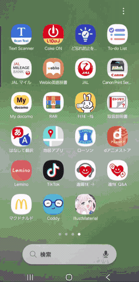
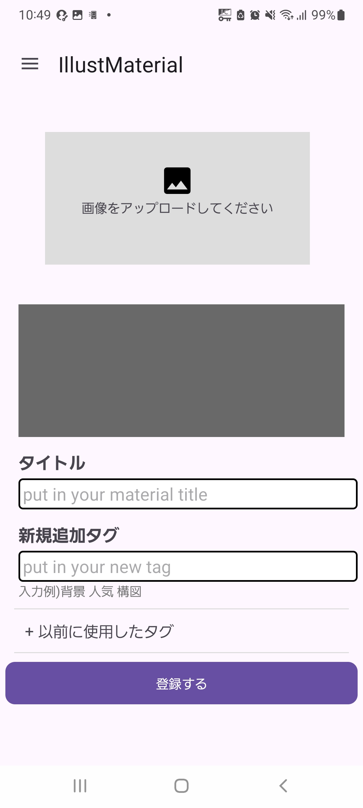
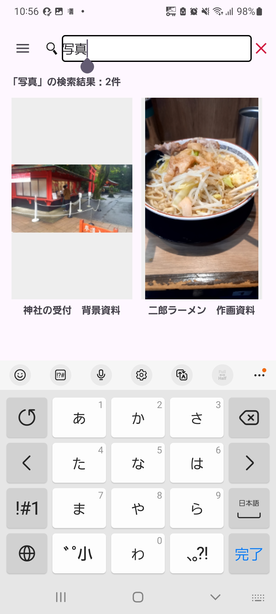
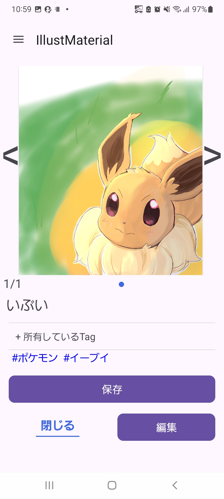

# IllustMaterial

イラスト制作で使用する参考資料を自分自身で登録し、検索、管理するAndroidアプリ

## コンセプト　自分だけの参考資料部屋をスマホで ##

## 実際の使用映像

使用画像は主にニコニ・コモンズ及び自作のイラストを使用しています。

### スクリーンショット

## 概要

IllustMaterialは、イラスト制作で使用する参考画像を効率的に管理するために開発したAndroidアプリです。

自身の制作活動で感じた「いい構図や、キャラの資料を検索する時間が惜しい」という課題をもとに企画し、Javaを中心としたデータ管理処理とKotlinによる画面・操作処理を組み合わせて個人開発しました。

## 開発背景・目的

イラスト制作の際、参考にしたい画像をスマートフォンのギャラリーに保存していました。しかし、日常の写真と制作資料が混在することで、必要な画像を探すのに時間がかかるという問題がありました。

そこで、制作資料を通常の写真から独立して管理し、タイトルやタグを利用して必要な画像に素早くアクセスできるアプリを企画・開発しました。

単に画像を保存するだけでなく、実際の制作活動で継続的に利用できることを意識して機能や操作性を設計しています。

## 主な機能

- **資料管理**
  - 複数画像を1つの資料として登録
  - 資料ごとのタイトル設定
  - アプリ内部ストレージへの画像・データ保存
  - データのダウンロード・アップロード

- **検索・分類**
  - タグの複数設定
  - タイトル・タグによる検索
  - 漢字の読みを利用した検索
  - 登録済みタグの管理

- **画像閲覧**
  - 画像の拡大表示
  - 複数画像の切り替え表示

- **一括操作**
  - 複数資料の選択
  - 選択した資料へのタグ一括追加
  - 選択した資料の一括削除

## 使用技術

| 分類 | 技術 |
|---|---|
| 言語 | Java / Kotlin |
| UI | XML |
| 開発環境 | Android Studio |
| ライブラリ | PhotoView / FlexboxLayout / Kuromoji |
| データ管理 | JSON / Android Internal Storage |

## 技術的な工夫・実装上の課題

### 1. 漢字の読みを利用した日本語検索

通常の文字列検索では、漢字で登録されたタグをひらがなで検索することができません。

そこで、Kuromojiを利用して漢字を含む文字列の読みを取得し、ひらがなによる検索にも対応させました。

タグの登録時に読みを管理することで、検索時に表記だけに依存せず、目的の資料を見つけられるようにしています。

### 2. 画像一覧の表示速度改善

大量の画像を扱うことを想定し、一覧画面にはRecyclerViewを採用しました。

RecyclerViewによるViewの再利用を活用し、表示に必要な要素を効率的に扱うことで、画像一覧の表示負荷を軽減しました。

実際の利用を想定した動作確認と改善を繰り返し、一覧表示の待ち時間を計測時に約13秒から約1秒まで短縮しました。

### 3. 複数画像を1つの資料として管理

1枚の画像を独立したデータとして扱うのではなく、1つの資料に複数の画像を関連付けるデータ構造を設計しました。

これにより、同じテーマや制作目的に関連する画像をまとめて管理できるようにしています。

### 4. データ管理とUI処理の分離

データ管理と画面・操作処理を分けて実装しました。

主なデータ構造は以下の通りです。

- `DataList`：登録されている資料全体を管理
- `Img`：1つの資料と、それに所属する複数画像を管理
- `TagList`：タグの一覧を管理
- `Tag`：タグ名・使用回数・読みを管理
- `ReadingChanger`：Kuromojiを利用した読みの変換

資料の情報はJSON形式で管理し、画像データは端末内部ストレージに保存しています。

## 開発で意識したこと

### 実際の利用を想定した機能設計

開発者自身が日常的に使用することを前提としているため、実装した機能が実際の制作作業の効率化につながるかを意識しました。

例えば、資料を1件ずつ編集する手間を減らすために、複数資料の選択やタグの一括追加・削除を実装しました。

### 利用者からの意見を取り入れた改善

自分だけでは気づきにくい操作性やUI上の問題を把握するため、複数の友人にアプリを使用してもらい、意見や改善点を収集しました。

その意見をもとに、UIや操作方法の見直しを行い、実際に継続して使いやすいアプリになるよう改善を重ねました。

## 今後の実装予定・改善課題

- イラスト依頼・制作物の締切管理
- リマインド機能
- windows,ios対応

# 要求定義書

# IllustMaterial 要求定義書

イラスト制作で使用する参考画像を登録・整理し、タイトルやタグを利用して効率的に検索・閲覧できるAndroidアプリです。

スマートフォンの通常のギャラリーとは独立して制作資料を管理し、必要な画像へ素早くアクセスできる環境を目指します。

## システム概要

### アプリ名：IllustMaterial

### 目的：
- イラスト制作で使用する参考資料の一元管理
- タイトルやタグによる資料の分類・検索
- 関連する複数画像を1つの資料としてまとめて管理
- 通常の写真と制作資料を分離し、資料を探す手間を削減
- 将来的なデータ共有や制作スケジュール管理への対応

### 対応プラットフォーム
Android

### 使用技術
- Java
- Kotlin
- XML
- JSON
- Android Internal Storage

## 機能要件

### 1. 画像の登録・管理

- 端末内の画像を読み込み、資料として登録
- 複数画像を1つの資料にまとめて登録
- 資料ごとのタイトル設定
- 登録した画像のアプリ内部ストレージへの保存
- 登録済み資料の閲覧・編集・削除

### 2. タグによる分類・検索

- 1つの資料に複数のタグを設定
- タグの新規作成・管理
- タイトルによる資料検索

## 非機能要求定義

### 1. データ保存・プライバシー
- 登録した画像と資料情報は端末内部ストレージに保存すること
- 通常のスマートフォンのギャラリーとは独立して資料を管理すること
- 外部サーバーへの画像データ送信を前提としない設計とすること

### 2. 操作性
- 多数の資料を登録しても目的の資料を検索できること
- 複数資料の一括操作に対応し、管理の手間を軽減すること
- 画像を直感的に閲覧・切り替えできること

### 3. 動作環境
- Android端末で動作すること
- 端末内部ストレージを利用してデータを管理すること

## データ構造・管理設計

### 資料データ
- `DataList`：登録されている資料全体を管理
- `Img`：資料のタイトル、所属画像、タグ情報を管理

### タグデータ
- `TagList`：登録されているタグ全体を管理
- `Tag`：タグ名、使用回数、読み情報を管理

### 保存形式
- 資料情報：JSON形式
- 画像データ：端末内部ストレージ

## 開発ロードマップ

### 1. アプリの基本設計・データ構造の設計

資料と画像の関連付け、タグ管理などの基本データ構造を設計し、JSON形式での保存方法を検討する。

### 2. Androidアプリ基盤構築

画像の読み込み、資料登録、タイトル設定、タグ管理などの基本機能を実装する。

### 3. 検索・画像閲覧機能の実装

タイトル・タグによる検索、複数画像の表示切り替え、画像の拡大表示などを実装する。

### 4. 資料の一括管理機能の実装

複数資料の選択、タグの一括追加、資料の一括削除などを実装する。

### 5. データ保存・バックアップ機能の実装

JSON形式による資料情報の保存と、画像データのインポート・エクスポート機能を実装する。

### 6. 動作確認・改善

実際の利用を想定した動作確認を行い、各機能の動作や操作性を検証する。

## 将来的な拡張予定

- イラスト依頼・制作物の締切管理
- リマインダー機能
- UI/UXの改善
